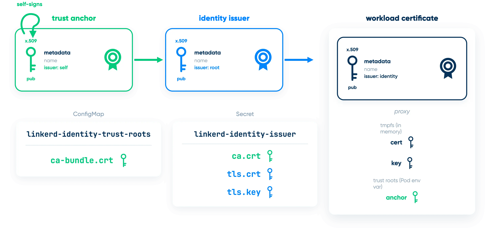
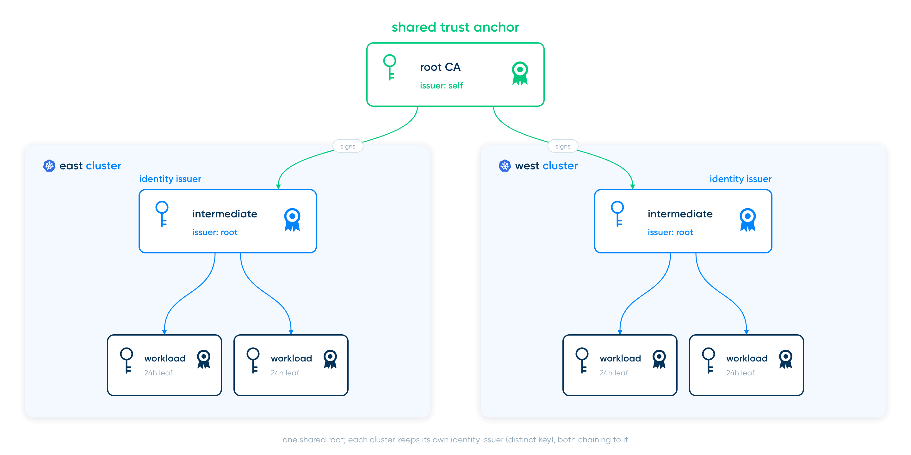
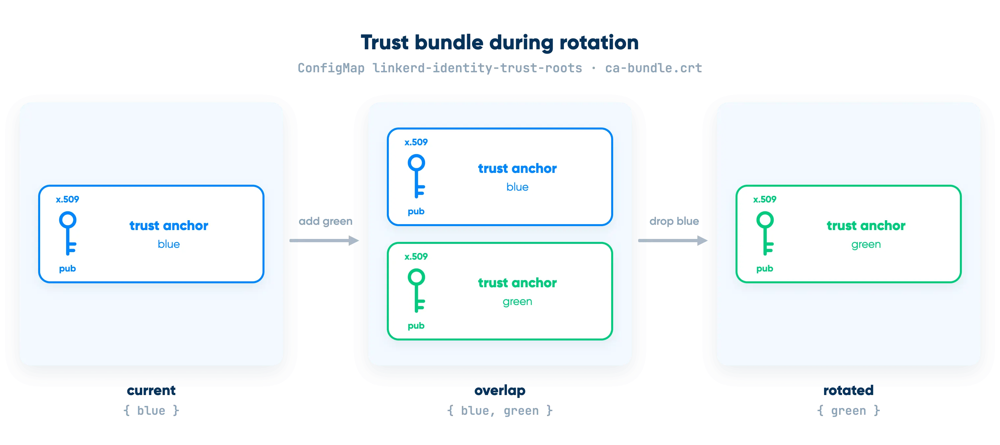
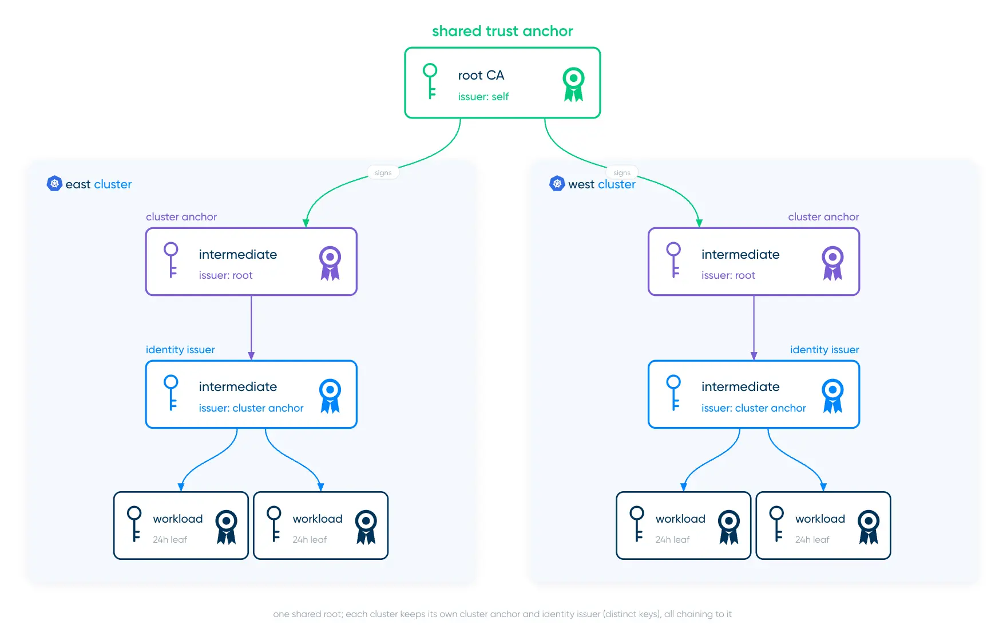
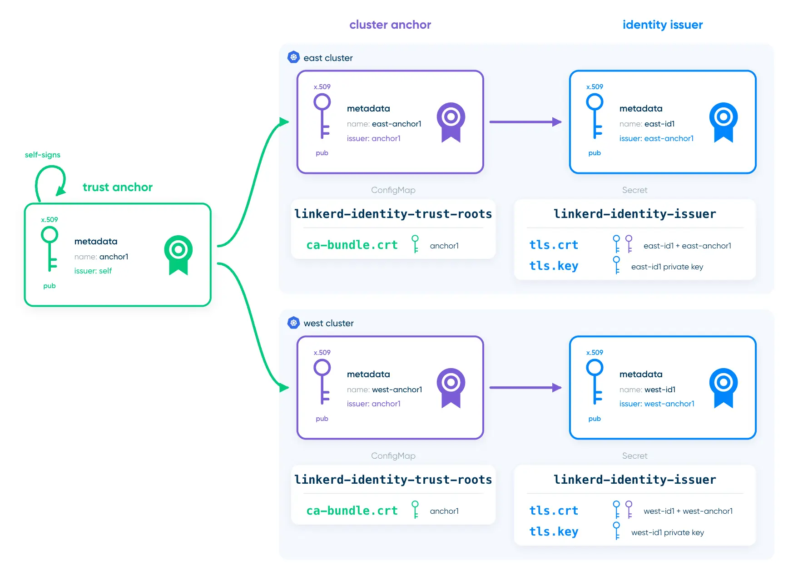

Trust is the beating heart of Linkerd.

OK, fine, we can be a little less dramatic about that. But providing
trust really is one of the most critical things that Linkerd does.
Microservices communicate over an untrusted, potentially hostile network;
without _something_ in place to allow a them to communicate securely,
it's not really possible to build safe real-world applications. Trust is
_important_.

As we've talked about in [many] [different] [places], Linkerd provides
trust using [X.509], which relies on certificates. Per the [Linkerd
docs], specifically, there are three certificates involved:



[many]: https://www.buoyant.io/blog/multicluster-mtls-the-trust-model-walked-through
[different]: /2024/02/06/linkerd-certificates-with-vault/
[places]: https://www.buoyant.io/blog/a-guide-to-linkerd-trust-anchor-rotation-with-cert-manager
[X.509]: https://en.wikipedia.org/wiki/X.509
[Linkerd docs]: /docs/tasks/automatically-rotating-control-plane-tls-credentials/

When one workload tries to talk to another, they exchange workload
certificates, which are signed by the identity issuer, which is signed by
the trust anchor. Each workload verifies the signing chain all the way up
to the trust anchor, and everything has to line up for the connection to
succeed.

The way this is typically extended to multicluster - including in our own
[multicluster documentation] - uses a single trust anchor that's shared
across all clusters and gives each cluster its own identity issuer:



[multicluster documentation]: /docs/tasks/multicluster/

This has the serious win that it follows naturally from the
single-cluster case, it's easy to explain, and it works. All of these are
good things. Where it falls down is if you ever have to rotate the trust
anchor. To show why, let's look at trust anchor rotation with just a
single cluster.

## Trust Anchor Rotation With One Cluster

The first thing to realize is that even though we often talk about a
Linkerd cluster having a trust _anchor_, what it actually has is a trust
_bundle_. The difference is that where the trust anchor is one
certificate by definition, the trust bundle can hold _multiple_
certificates. When Linkerd traces the signature chain for a workload
cert, any certificate in the trust bundle is as good as any other.

Using a bundle is the reason that zero-downtime trust anchor rotation is
possible at all. You can't atomically swap the trust anchor across every
meshed workload simultaneously -- instead, there's a multi-step process
for rotating a trust anchor.

We'll start by assuming that the cluster is using trust anchor `blue` and
identity issuer `blue-id` (which is signed by `blue`). Then, to rotate
the trust anchor:

1. Generate a new trust anchor (`green`) and an identity issuer signed by
   it (`green-id`).

2. **Add** `green` to the cluster's trust bundle. At this moment, the
   bundle contains both `blue` and `green`, and either is fine for
   establishing that an identity is valid.

    

3. Restart the Linkerd control plane so that everything in the control
   plane is using the updated trust bundle.

4. Restart all of the meshed workloads on the cluster so that all the
   proxies in the cluster are using the updated trust bundle.

    At this point, both `blue` and `green` are valid, but the identity
    issuer is still `blue-id` so all our workload certificates are still
    ultimately signed by `blue`.

5. Update the identity issuer to `green-id`.

    Newly-created pods will now get workload certificates ultimately
    signed by `green`, but there are still plenty of running pods with
    workload certificates signed by `blue`.

6. Restart the control plane again, then restart the meshed workloads again.

    At this point everything in the system will be using a workload
    certificate ultimately signed by `green`. `blue` is no longer
    relevant. However, everything has a trust bundle declaring that
    `blue` is still valid.

7. Remove `blue` from the trust bundle.

8. Restart the control plane and all meshed workloads one final time.

    This, finally, gets everyone to a trust bundle in which only `green`
    is valid.

This is annoying in a single-cluster setup, but if you stick carefully to
the process it's definitely tractable (and, of course, if you're running
[Buoyant Enterprise for Linkerd] you can use the [Trust Anchor Rotation
Operator], which makes it much simpler).

[Buoyant Enterprise for Linkerd]: https://buoyant.io/enterprise-linkerd/
[Trust Anchor Rotation Operator]:
https://docs.buoyant.io/buoyant-enterprise-linkerd/latest/features/trust-rotation/

## What About Multicluster?

In multicluster, things get more annoying. While you follow the same
process, remember that every cluster has the same trust anchor -- which
means that every time you modify a certificate or restart, you have to do
that on _every cluster at the same time_.

So when you add `green` to the trust bundle, you have to add it to the
trust bundle on _every_ cluster. Then you have to restart the control
plane on _every_ cluster. Then you have to restart the meshed workloads
on _every_ cluster. You get the picture: it's much more error-prone and
unpleasant.

It's also potentially more subtle when things go wrong. Suppose the
workloads in cluster-1 only call workloads that are also in cluster-1,
but every so often a workload in a cluster-2 calls something in
cluster-1. If the cluster-1 operator jumps the gun, everything will look
great in cluster-1, even though cluster-2 might be totally down because
it suddenly can't talk to cluster-1.

I've written demos of this for two or three clusters, and it's manageable
but annoying... but we have users with many more than three clusters, and
that's a different world. There needs to be a better way.

## The Better Way: Federated Anchors

The better way is something I call _federated anchors_. In the grand
tradition of fixing problems in computing by throwing a layer of
indirection at it, the federated-anchors concept works by sneaking an
extra layer of certificates into the cluster.



In this model, the trust anchor still spans all the clusters, but there's
an extra _cluster anchor_ for each cluster. This setup has some
interesting characteristics:

* Multicluster still works because, ultimately, everything is signed by
  the same trust anchor, which means that the whole trust hierarchy is
  still intact.

* Cluster anchors have much the same security profile as single-cluster
  trust anchors: their secret keys are infrequently used and can easily
  stay completely off the cluster.

* Using the cluster anchor to sign the identity issuer means that the
  trust anchor's secret key is used even less frequently than before,
  making it safer to allow the trust anchor to be very long-lived.

* Finally, the _coup de grace_: you can rotate cluster anchors and
  identity issuers one cluster at a time, without ever having to touch
  the other clusters, while maintaining zero downtime.

## How Federated Anchors Work

Federated anchors work by taking advantage of a little-known fact about
Linkerd: the identity issuer is _also_ actually a bundle. It's not widely
advertised (yet!) because it's rarely useful in the single-cluster case,
but including multiple certificates in the identity issuer Secret works
just fine. You only get one private key (which is a feature in this case,
not a bug), and it pretty much only makes sense if the multiple
certificates form a signing chain, but some pretty fascinating use cases
lie well within those boundaries.

So if we have clusters named "east" and "west", and we want to use
federated anchors:

* We'll have a single shared trust anchor. Call this `anchor1`.
* Each cluster will have its own cluster anchor:
  * `east-anchor1` for the east cluster, signed by `anchor1`
  * `west-anchor1` for the west cluster, also signed by `anchor1`.
* Each cluster will also have its own identity issuer:
  * `east-id1` for the east cluster, signed by `east-anchor1`
  * `west-id1` for the west cluster, signed by `west-anchor1`

Remember that each of these has a public half (e.g. `anchor1.pem`) and a
private half (e.g. `anchor1.key`). So to configure Linkerd on the east
cluster:

* We'll put `anchor1.pem` into the `ca-bundle.crt` key of the
  `linkerd-identity-trust-roots` ConfigMap.
* We'll concatenate `east-anchor1.pem` and `east-id1.pem` and store that
  in the `crt.pem` key of the `linkerd-identity-issuer` Secret.
* We'll store `east-id1.key` in the `key.pem` key of the
  `linkerd-identity-issuer` Secret.
* We'll let Linkerd worry about the workload certs.



**Read that very carefully:** the trust bundle contains the public half
of `anchor1`, and the identity issuer Secret contains the private key of
`east-id1` but the public halves of both `east-anchor1` and `east-id1`.

## Setting Up With `linkerd x-trust`

The `linkerd-x-trust` GitHub repo at
<https://github.com/kflynn/linkerd-x-trust> contains an **experimental**
Linkerd extension that can make this a little simpler to work with. Check
out the [README] for how to install it.

[README]: https://github.com/kflynn/linkerd-x-trust/blob/main/README.md

### Creating the trust anchor

Creating a self-signed trust anchor with `linkerd-x-trust` is
straightforward, with one caveat: we have to set the X.509 _path length_.
The path length is the number of certificates below this one are allowed
to sign other certificates: normally, it's set to 1 for a trust anchor,
since the only signing certificate below the trust anchor is the identity
issuer. We need it to be 2, to leave room for the cluster anchor as well.

```bash
linkerd x-trust anchor generate --pathlen 2 \
   anchor1.crt anchor1.key
```

This will write `anchor1.crt` and `anchor1.key`, containing the trust
anchor we'll use.

Next, we'll create `east-anchor1` and `west-anchor1`. We'll tell `linkerd
x-trust` to generate an identity issuer certificate for this, but again
we'll override the path length -- it's normally 0 for an identity issuer,
but we need 1. We'll also override the DNS name contained in the
certificate. Linkerd doesn't use this name for anything, but it can make
life easier when debugging to have unique values, so we'll override it.

```bash
linkerd x-trust issuer generate anchor1.crt anchor1.key \
   --identity "east-anchor.linkerd.cluster.local" \
   --pathlen 1 \
   east-anchor1.crt east-anchor1.key

linkerd x-trust issuer generate anchor1.crt anchor1.key \
   --identity "west-anchor.linkerd.cluster.local" \
   --pathlen 1 \
   west-anchor1.crt west-anchor1.key
```

Finally, we create `east-id1` and `west-id1`. For this, we don't really
need to override anything; the normal identity issuer that `linkerd
x-trust` can create will work fine. Again, though, we'll override the DNS
name to be unique.

```bash
linkerd x-trust issuer generate east-anchor1.crt east-anchor1.key \
   --identity "east-issuer.linkerd.cluster.local" \
   east-id1.crt east-id1.key

linkerd x-trust issuer generate west-anchor1.crt west-anchor1.key \
   --identity "west-issuer.linkerd.cluster.local" \
   --pathlen 1 \
   west-id1.crt west-id1.key
```

Given all the certificates, we can then push them out for Linkerd to use
them (which, of course, requires Linkerd to be running):

```bash
linkerd x-trust --kubeconfig east-kubeconfig.yaml \
  bundle add anchor1.crt

linkerd x-trust --kubeconfig east-kubeconfig.yaml \
  identity update east-anchor1.crt east-id1.crt east-id1.key

linkerd x-trust --kubeconfig west-kubeconfig.yaml \
  bundle add anchor2.crt

linkerd x-trust --kubeconfig west-kubeconfig.yaml \
  identity update west-anchor1.crt west-id1.crt west-id1.key
```

Remove any leftover trust anchor from the trust bundles using `linkerd
x-trust bundle remove`, then restart Linkerd and any meshed workloads
with `kubectl rollout restart`. After that, you should be able to verify
a four-certificate chain for each cluster:

```bash
linkerd x-trust --kubeconfig east-kubeconfig.yaml \
   chain

linkerd x-trust --kubeconfig east-kubeconfig.yaml \
   chain
```

## Rotating a Cluster Anchor

Once you have all of that in place, rotating a cluster anchor only
touches that single cluster. For example, to rotate the east cluster's
cluster anchor:

1. Generate a new cluster trust anchor and identity issuer, possibly with
   `linkerd x-trust issuer` as shown above:

    ```bash
    # Don't forget the path length here!
    linkerd x-trust issuer generate anchor1.crt anchor1.key \
       --identity "east-anchor2.linkerd.cluster.local" \
       --pathlen 1 \
       east-anchor2.crt east-anchor2.key

    linkerd x-trust issuer generate east-anchor2.crt east-anchor2.key \
       --identity "east-issuer2.linkerd.cluster.local" \
       east-id2.crt east-id2.key
    ```

2. Update the identity issuer bundle on the east cluster to have all four
   `east` certificates:

    ```bash
    linkerd x-trust issuer update \
        east-anchor1.crt east-id1.crt east-anchor2.crt east-id2.crt \
        east-id1.key
    ```

   Note that we still passed `east-id1.key` here -- we can't change that yet.

3. Restart the Linkerd control plane, then restart all meshed workloads.
   Again, this happens _only_ in cluster 1.

4. Switch the identity issuer to use `east-id2`'s private key (all that
   changes here is the last parameter):

    ```bash
    linkerd x-trust issuer update \
        east-anchor1.crt east-id1.crt east-anchor2.crt east-id2.crt \
        east-id2.key
    ```

5. Restart the Linkerd control plane and meshed workloads again.

6. Drop the original cluster anchor and identity issuer from the bundle:

    ```bash
    linkerd x-trust issuer update \
        east-anchor2.crt east-id2.crt \
        east-id2.key
    ```

7. Finally, restart one more time.

This is still a bit of a process, but it only involves a single cluster
now, which makes life vastly better. The cluster-specific keys don't need
to get tangled up in all the other clusters.

## What About Rotating the Trust Anchor?

Sadly, federated anchors _don't_ help with the process of rotating the
actual trust anchor. In fact, not only does it still require wrangling
every certificate in lockstep, but you'll also have to generate new
cluster anchors as well, so arguably it's slightly more annoying.

The important bit, though, is that since the only thing the trust anchor
private key is used for is to sign cluster anchors, and the trust anchor
private key should never be on the clusters ever, it's safe to give the
trust anchor a very long lifespan. And rotating cluster anchors is
sufficiently less painful to be done more often. Federated anchors don't
eliminate the need to handle keys safely, but they _do_ eliminate a very
painful operational headache, replacing it with one that's much more
tractable.
